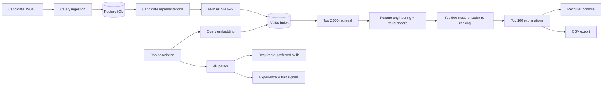
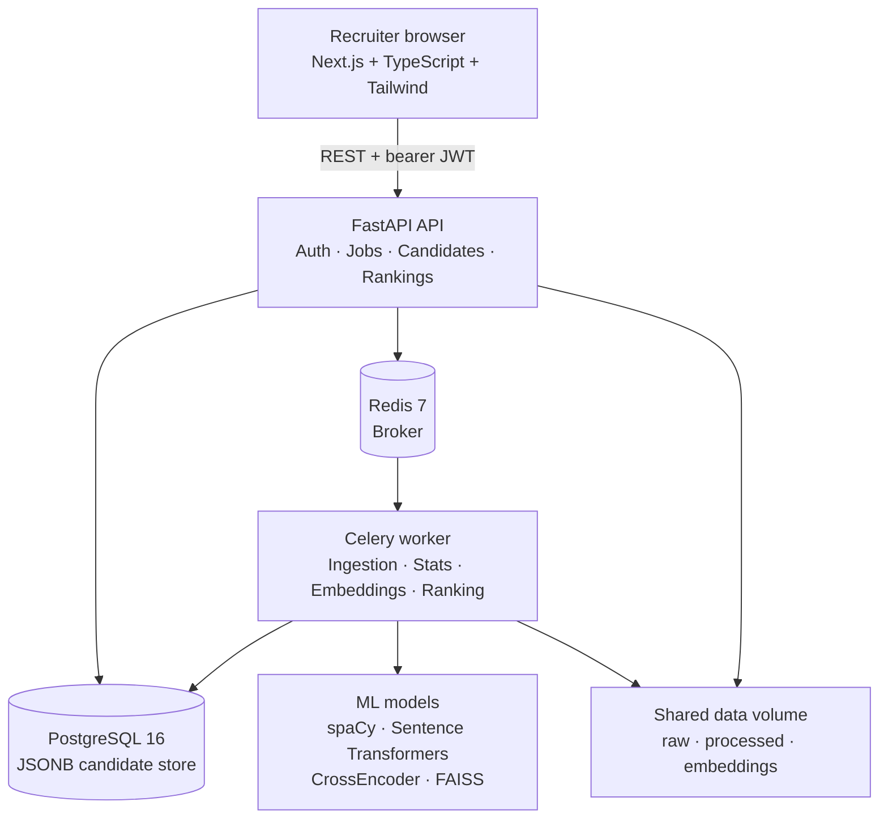

<div align="center">

# HireMind AI

### Find the people behind the keywords.

An explainable candidate discovery and ranking workspace for recruiters who need better shortlists, stronger signals, and less manual screening.

<p>
  <a href="#-why-hiremind-ai">Why HireMind</a> ·
  <a href="#-how-it-works">How it works</a> ·
  <a href="#-quick-start">Quick start</a> ·
  <a href="#-api-surface">API</a> ·
  <a href="#-project-layout">Project layout</a>
</p>

<p>
  
  
  
  
  
  
</p>

</div>

<br>

> **The short version:** HireMind AI turns a job description and a large candidate pool into a ranked, risk-aware, explainable shortlist—through one recruiter-friendly workflow.

## ✨ Why HireMind AI

Most applicant search tools stop at keyword overlap. HireMind AI combines semantic retrieval, structured feature engineering, recruiter signals, fraud checks, and neural re-ranking so a shortlist is not only **relevant**, but also **defensible**.

| What recruiters need | What HireMind provides |
| --- | --- |
| Search beyond exact keywords | 384-dimensional semantic embeddings and FAISS similarity retrieval |
| Compare candidates consistently | Weighted rules across skills, experience, production, availability, behavior, credibility, and risk |
| Catch suspicious profiles early | Timeline overlap, experience discrepancy, skill inflation, contradictory summaries, and synthetic-profile signals |
| Know why someone ranked highly | Structured strengths, weaknesses, reasoning, confidence, and feature-level evidence |
| Move from analysis to action | Recruiter dashboard, job workspace, progress states, candidate detail views, and CSV shortlist export |

## 🎯 The recruiter experience

1. **Bring in the pool** — import newline-delimited JSON candidate profiles in memory-conscious batches.
2. **Stage the role** — paste a job description or create a job profile in the web console.
3. **Let the pipeline work** — the system parses requirements, retrieves semantic matches, engineers signals, re-ranks, and explains.
4. **Review the shortlist** — inspect scores, strengths, weaknesses, confidence, availability, and fraud indicators.
5. **Export the decision set** — download the completed top-100 shortlist as a compact CSV report.

## 🧠 How it works



### Ranking funnel

| Stage | What happens | Output |
| --- | --- | --- |
| **Understand** | Extract skills, experience range, traits, and negative signals from the JD | Structured role profile |
| **Retrieve** | Embed the role and search the FAISS index using cosine-style inner-product similarity | Up to **2,000** candidates |
| **Engineer** | Calculate match, production, retrieval, startup, stability, behavior, availability, credibility, and fraud features | Comparable candidate signals |
| **Re-rank** | Apply `cross-encoder/ms-marco-MiniLM-L-6-v2` to the strongest retrieved candidates | Top **500** refined matches |
| **Explain** | Generate human-readable strengths, weaknesses, reasoning, and confidence | Top **100** shortlist items |

The default rules score is intentionally inspectable:

```text
semantic match      35%     production experience  20%
retrieval expertise 15%     behavior                10%
experience          10%     availability             5%
credibility          5%     fraud penalty           20%
```

The final ranking blends the rules score with the cross-encoder signal (`60% rules + 40% neural re-ranking`).

## 🖥️ Product surface

The Next.js console is designed as a dark, glassmorphic operations workspace rather than a generic admin panel:

- **Landing workspace** for staging a role and seeing connected dataset health
- **Recruiter dashboard** with candidate, job, ranking, and infrastructure status cards
- **Candidate explorer** with search and structured profile data
- **Job workspace** for creating, managing, and launching ranking runs
- **Ranking view** with pipeline states from `PARSING_JD` through `EXPLAINING`
- **Analytics** for skill distribution, experience buckets, and dataset health
- **Export flow** for completed shortlist runs

## 🏗️ Architecture



### Technology choices

| Layer | Technologies |
| --- | --- |
| Web | Next.js App Router, React 19, TypeScript, Tailwind CSS v4, Auth.js, Recharts, Framer Motion, Lucide |
| API | FastAPI, Pydantic v2, SQLAlchemy 2, JWT, bcrypt, Loguru |
| Async work | Celery 5 + Redis 7 |
| Data | PostgreSQL 16 with JSONB and GIN full-text search |
| Retrieval | `all-MiniLM-L6-v2` embeddings, FAISS HNSW / inner-product search |
| Re-ranking | `cross-encoder/ms-marco-MiniLM-L-6-v2` |
| NLP | spaCy `en_core_web_sm` with a deterministic fallback tokenizer |

## 🚀 Quick start

### Prerequisites

- Docker Engine with Docker Compose
- At least **8 GB RAM** recommended for the API image and transformer models
- Ports `3000` and `8000` available

### 1. Start the stack

```bash
git clone https://github.com/ampere207/HireMind-AI.git
cd HireMind-AI

docker compose up --build
```

The first build downloads the spaCy, embedding, and cross-encoder models, so the initial startup is intentionally heavier.

Open:

- **Web console:** http://localhost:3000
- **API:** http://localhost:8000
- **Interactive API docs:** http://localhost:8000/docs

### 2. Create a recruiter account

Use the web console at `/register`, or call the API:

```bash
curl -X POST http://localhost:8000/auth/register \
  -H "Content-Type: application/json" \
  -d '{
    "email": "recruiter@example.com",
    "password": "change-me",
    "name": "Recruiting Team"
  }'
```

### 3. Generate a local candidate pool

The repository includes a realistic mock data generator for development and demos:

```bash
python scripts/generate_mock_candidates.py \
  --count 10000 \
  --output data/raw/candidates.jsonl
```

The default generator count is `100000`. Adjust it to match the memory and runtime available on your machine.

### 4. Start candidate ingestion

Authenticate in the web console, or obtain a token from `/auth/login`, then trigger the background import:

```bash
curl -X POST http://localhost:8000/candidates/import \
  -H "Authorization: Bearer <ACCESS_TOKEN>" \
  -H "Content-Type: application/json" \
  -d '{"file_path":"data/raw/candidates.jsonl"}'
```

The import task reads one record at a time and upserts in batches of **2,000**. Monitor progress from `/tasks` or the dashboard.

### 5. Run a ranking

Create a job in the console, then start a ranking run from the **Rankings** view. The default asynchronous flow reports:

```text
PENDING → PARSING_JD → RETRIEVING → ENGINEERING_FEATURES
        → RERANKING → EXPLAINING → COMPLETED
```

On completion, the run detail endpoint exposes the shortlist and `/rank/{run_id}/export` returns the CSV report.

## 🔌 API surface

All application routes except `/`, `/health`, and authentication registration/login require a bearer token.

| Area | Routes | Purpose |
| --- | --- | --- |
| Health | `GET /`, `GET /health` | Service and connection checks |
| Auth | `POST /auth/register`, `POST /auth/login`, `GET /auth/me` | Recruiter identity and JWT sessions |
| Candidates | `GET /candidates`, `GET /candidates/{id}`, `GET /candidates/search` | Browse, search, and filter the candidate pool |
| Ingestion | `POST /candidates/import` | Queue JSONL candidate ingestion |
| Jobs | `POST /jobs`, `GET /jobs`, `GET /jobs/{id}`, `DELETE /jobs/{id}` | Manage recruiter-scoped job profiles |
| Ranking | `POST /rank`, `GET /rank`, `GET /rank/{id}` | Create and inspect ranking runs |
| Ranking | `POST /jobs/{id}/rankings` | Queue a ranking run for an existing job |
| Retrieval | `POST /rank/retrieve` | Query semantic retrieval without the full ranking pipeline |
| Export | `GET /rank/{id}/export` | Download a completed shortlist as CSV |
| Dataset | `GET /dataset/stats`, `POST /dataset/stats/rebuild` | Read or rebuild aggregate dataset statistics |
| Tasks | `GET /tasks`, `GET /tasks/{id}` | Inspect Celery task state |

FastAPI generates the complete interactive schema at [`/docs`](http://localhost:8000/docs) when the stack is running.

## 📁 Project layout

```text
.
├── apps/
│   ├── api/
│   │   ├── app/
│   │   │   ├── routers/       # HTTP endpoints
│   │   │   ├── services/      # Parsing, retrieval, ranking, fraud, explanations
│   │   │   ├── tasks/         # Celery workflows
│   │   │   ├── repositories/  # Database access
│   │   │   └── models/        # SQLAlchemy models
│   │   ├── tests/             # API and ranking tests
│   │   └── requirements.txt
│   └── web/
│       ├── src/app/           # Landing, auth, dashboard, ranking routes
│       ├── src/components/    # Shared UI
│       └── src/lib/           # API client and shared browser logic
├── data/
│   ├── raw/                   # Candidate JSONL input
│   ├── processed/             # Generated dataset statistics
│   └── embeddings/            # Cached embeddings and FAISS index
├── docker/                    # API, worker, and web images
├── packages/                  # Shared TypeScript types and UI package
├── scripts/                  # Local data-generation utilities
├── docker-compose.yml
└── README.md
```

## 🧪 Development commands

Run backend tests from the API directory:

```bash
cd apps/api
pytest
```

Run frontend linting from the web directory:

```bash
cd apps/web
npm install
npm run lint
```

For focused local development, start the web app with `npm run dev` and the API with `uvicorn app.main:app --reload --port 8000`. PostgreSQL and Redis still need to be available, so Docker Compose is the recommended path.

## 🔐 Data and security notes

- Recruiter accounts, job descriptions, and ranking runs are scoped through the authenticated user.
- Candidate records are stored as structured JSONB fields for profile, career, skills, education, and recruiter signals.
- Local development defaults are intentionally simple; change database credentials, CORS, and JWT-related settings before any shared or deployed environment.
- Generated candidate data, embeddings, logs, and processed statistics are ignored by Git and remain local to the workspace.

## 🗺️ Roadmap opportunities

The foundation is ready for the next layer of product depth:

- persistent model/index paths configurable per environment
- true PDF/DOCX text extraction for uploaded job descriptions
- incremental index updates after candidate ingestion
- recruiter-configurable score weights in the UI
- richer audit trails for ranking decisions
- deployment manifests and production secret management

## 📄 License

No license file is currently included in this repository. Add a license before distributing HireMind AI outside the project team.

<div align="center">

### Hire smarter. Explain every shortlist.

</div>
